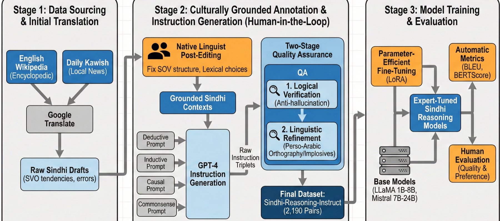

# Sindhi-Reasoning-Instruct

**Culturally grounded instruction data for structured reasoning in Sindhi**

[](https://aclanthology.org/2026.loreslm-1.22/)
[](https://huggingface.co/datasets/Kamyar-zeinalipour/sindi_reasoning)
[](https://huggingface.co/collections/Kamyar-zeinalipour/sindhi-reasoning-instruct-loreslm-2026-6af467d9e0f19e13ad2d14c0)
[](LICENSE)
[](data/README.md#license)

Sindhi is spoken by more than 40 million people but has almost no resources for reasoning in
language models. **Sindhi-Reasoning-Instruct** is the first culturally grounded Sindhi instruction
corpus for structured reasoning: 2,189 question–answer items over Sindhi passages, each requiring
**deductive, inductive, causal or commonsense** reasoning, written in authentic Perso-Arabic Sindhi
and checked by native linguists. LoRA fine-tuning on it lets Llama and Mistral models (1B–24B)
answer in correct Sindhi and reason over the passage; Mistral-Small-24B's mean human rating rises
by 141% over its base model.

This repository accompanies the paper
[*Enabling Structured Reasoning in Sindhi with Culturally Grounded Instruction Tuning*](https://aclanthology.org/2026.loreslm-1.22/)
(LoResLM 2026) and releases the dataset, the generation prompt, training, inference and evaluation
code, the paper's results, and the six LoRA adapters.

<p align="center"></p>

## Contents

- [The data](#the-data)
- [Fine-tuned adapters](#fine-tuned-adapters)
- [Repository layout](#repository-layout)
- [Setup](#setup)
- [Reproducing the experiments](#reproducing-the-experiments)
- [Results](#results)
- [Citation](#citation)

## The data

| | Train | Test |
|---|---:|---:|
| Items | 2,089 | 100 |
| Passages | 965 | 96 |
| Deductive / Inductive / Causal / Commonsense | 567 / 573 / 474 / 475 | 30 / 24 / 24 / 22 |

```python
import pandas as pd

test = pd.read_json("data/sindhi_reasoning_test.jsonl.gz", lines=True)
row = test.iloc[0]
print(row.reasoning_type, "|", row.question)
print(row.answer)
```

Passages come from Sindhi Wikipedia, post-edited translations of English Wikipedia and the Daily
Kawish newspaper. GPT-4 drafted the items with the prompt in
[`assets/generation_prompt.png`](assets/generation_prompt.png); two Sindhi linguists verified the
logic and corrected orthography and grammar. Fields and notes are in the [data card](data/README.md).

## Fine-tuned adapters

In the [Sindhi-Reasoning collection](https://huggingface.co/collections/Kamyar-zeinalipour/sindhi-reasoning-instruct-loreslm-2026-6af467d9e0f19e13ad2d14c0):

| Base model | Params | Adapter | BERTScore F1 (base → fine-tuned) |
|---|---:|---|---|
| [Llama-3.2-1B-Instruct](https://huggingface.co/meta-llama/Llama-3.2-1B-Instruct) | 1B | [Sindhi-Reasoning-Llama-3.2-1B-Instruct-LoRA](https://huggingface.co/Kamyar-zeinalipour/Sindhi-Reasoning-Llama-3.2-1B-Instruct-LoRA) | 0.850 → **0.890** |
| [Llama-3.2-3B-Instruct](https://huggingface.co/meta-llama/Llama-3.2-3B-Instruct) | 3B | [Sindhi-Reasoning-Llama-3.2-3B-Instruct-LoRA](https://huggingface.co/Kamyar-zeinalipour/Sindhi-Reasoning-Llama-3.2-3B-Instruct-LoRA) | 0.867 → **0.901** |
| [Llama-3.1-8B-Instruct](https://huggingface.co/meta-llama/Llama-3.1-8B-Instruct) | 8B | [Sindhi-Reasoning-Llama-3.1-8B-Instruct-LoRA](https://huggingface.co/Kamyar-zeinalipour/Sindhi-Reasoning-Llama-3.1-8B-Instruct-LoRA) | 0.895 → **0.918** |
| [Mistral-7B-Instruct-v0.3](https://huggingface.co/mistralai/Mistral-7B-Instruct-v0.3) | 7B | [Sindhi-Reasoning-Mistral-7B-Instruct-v0.3-LoRA](https://huggingface.co/Kamyar-zeinalipour/Sindhi-Reasoning-Mistral-7B-Instruct-v0.3-LoRA) | 0.877 → **0.916** |
| [Mistral-Nemo-Instruct-2407](https://huggingface.co/mistralai/Mistral-Nemo-Instruct-2407) | 12B | [Sindhi-Reasoning-Mistral-Nemo-Instruct-2407-LoRA](https://huggingface.co/Kamyar-zeinalipour/Sindhi-Reasoning-Mistral-Nemo-Instruct-2407-LoRA) | 0.871 → **0.915** |
| [Mistral-Small-24B-Instruct-2501](https://huggingface.co/mistralai/Mistral-Small-24B-Instruct-2501) | 24B | [Sindhi-Reasoning-Mistral-Small-24B-Instruct-2501-LoRA](https://huggingface.co/Kamyar-zeinalipour/Sindhi-Reasoning-Mistral-Small-24B-Instruct-2501-LoRA) | 0.864 → **0.922** |

```bash
python inference/generate.py --model mistralai/Mistral-Small-24B-Instruct-2501 \
  --adapter Kamyar-zeinalipour/Sindhi-Reasoning-Mistral-Small-24B-Instruct-2501-LoRA --limit 5
```

## Repository layout

```
Sindhi-Reasoning/
├── data/                     train/test items + data card
├── assets/                   pipeline figure, instruction-generation prompt (paper Fig. 7)
├── training/                 LoRA fine-tuning (train.py, utils.py)
├── configs/                  training settings, DeepSpeed ZeRO-3 config
├── inference/generate.py     answers from a base model or adapter
├── evaluation/
│   ├── metrics.py            ROUGE, BLEU, TF-IDF, E5 and XLM-R similarity, BERTScore
│   └── human_evaluation.md   rating rubric (A–E) and preference protocol
├── paper_results/            automatic_metrics.csv (Table 4), human_eval.csv
└── scripts/                  train_all.sh, infer_all.sh, evaluate_all.sh
```

## Setup

```bash
git clone https://github.com/KamyarZeinalipour/Sindhi-Reasoning.git
cd Sindhi-Reasoning
conda create -n sindhi python=3.11 -y && conda activate sindhi
pip install -r requirements.txt        # training and inference (versions used in the paper)
pip install -r requirements-eval.txt   # automatic metrics
```

The Llama and Mistral models are gated on the Hugging Face Hub: accept their terms on each model
page and run `huggingface-cli login`.

## Reproducing the experiments

```bash
scripts/train_all.sh      # LoRA fine-tuning of the six models (DeepSpeed ZeRO-3, 3 GPUs)
scripts/infer_all.sh      # base and fine-tuned answers on the test split -> results/raw/
scripts/evaluate_all.sh   # automatic metrics -> results/metrics/summary_metrics.csv
```

Training settings (`configs/train_lora.json`, as stored with the released adapters): LoRA r = 64,
α = 128, dropout 0.1 on all attention and MLP projections plus `embed_tokens` and `lm_head`;
3 epochs; AdamW, learning rate 1e-4, cosine schedule, weight decay 1e-4; 4 sequences per GPU,
2 gradient-accumulation steps, packing to 2,048 tokens; bf16, Flash Attention 2, seed 100.
Decoding: temperature 0.8, top-p 0.95, top-k 50, repetition penalty 1.1, up to 2,048 new tokens.

## Results

Automatic metrics on the test split, base → fine-tuned (Table 4 of the paper):

| Model | ROUGE-L | BLEU | TF-IDF | E5 sim. | BERTScore F1 |
|---|---|---|---|---|---|
| Llama-3.2-1B-Instruct | 0.225 → **0.331** | 0.067 → **0.159** | 0.141 → **0.264** | 0.863 → **0.894** | 0.850 → **0.890** |
| Llama-3.2-3B-Instruct | 0.296 → **0.364** | 0.119 → **0.182** | 0.198 → **0.322** | 0.892 → **0.918** | 0.867 → **0.901** |
| Llama-3.1-8B-Instruct | 0.363 → **0.431** | 0.170 → **0.247** | 0.304 → **0.418** | 0.914 → **0.943** | 0.895 → **0.918** |
| Mistral-7B-Instruct-v0.3 | 0.317 → **0.426** | 0.126 → **0.247** | 0.266 → **0.421** | 0.886 → **0.940** | 0.877 → **0.916** |
| Mistral-Nemo-Instruct-2407 | 0.307 → **0.419** | 0.133 → **0.234** | 0.225 → **0.395** | 0.893 → **0.941** | 0.871 → **0.915** |
| Mistral-Small-24B-Instruct-2501 | 0.288 → **0.441** | 0.123 → **0.257** | 0.170 → **0.437** | 0.892 → **0.948** | 0.864 → **0.922** |

Human evaluation on the test split (mean rating A = 5 … E = 1, and how often the fine-tuned answer
was preferred over the base answer). Protocol: [`evaluation/human_evaluation.md`](evaluation/human_evaluation.md).

| Model | Base rating | Fine-tuned rating | Relative gain | Fine-tuned preferred |
|---|---:|---:|---:|---:|
| Llama-3.2-1B-Instruct | 1.08 | **2.03** | +88% | 100% |
| Llama-3.2-3B-Instruct | 1.62 | **2.96** | +83% | 92% |
| Llama-3.1-8B-Instruct | 3.13 | **4.32** | +38% | 91% |
| Mistral-7B-Instruct-v0.3 | 2.21 | **3.52** | +59% | 92% |
| Mistral-Nemo-Instruct-2407 | 1.67 | **3.25** | +95% | 93% |
| Mistral-Small-24B-Instruct-2501 | 1.49 | **3.59** | +141% | 96% |

Per-reasoning-type results and rating counts are in [`paper_results/`](paper_results/).

## Citation

```bibtex
@inproceedings{mehak-etal-2026-enabling,
    title = "Enabling Structured Reasoning in {S}indhi with Culturally Grounded Instruction Tuning",
    author = "Mehak, Mehak  and
      Zeinalipour, Kamyar  and
      Soomro, Pireh  and
      Chesi, Cristiano  and
      Gori, Marco  and
      Maggini, Marco",
    editor = "Hettiarachchi, Hansi  and
      Ranasinghe, Tharindu  and
      Plum, Alistair  and
      Rayson, Paul  and
      Mitkov, Ruslan  and
      Gaber, Mohamed  and
      Premasiri, Damith  and
      Tan, Fiona Anting  and
      Uyangodage, Lasitha",
    booktitle = "Proceedings of the Second Workshop on Language Models for Low-Resource Languages ({L}o{R}es{LM} 2026)",
    month = mar,
    year = "2026",
    address = "Rabat, Morocco",
    publisher = "Association for Computational Linguistics",
    url = "https://aclanthology.org/2026.loreslm-1.22/",
    doi = "10.18653/v1/2026.loreslm-1.22",
    pages = "239--258",
    ISBN = "979-8-89176-377-7"
}
```

## License

Code: [Apache License 2.0](LICENSE). Data: [CC BY-NC 4.0](https://creativecommons.org/licenses/by-nc/4.0/)
(part of the source text comes from a newspaper). Adapters follow the license of their base model.

Questions or problems: please [open an issue](https://github.com/KamyarZeinalipour/Sindhi-Reasoning/issues).
